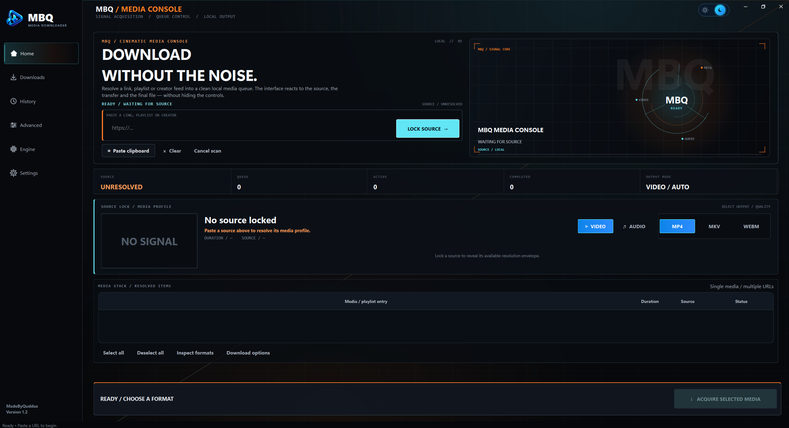

[](LICENSE)


# MBQ Media Downloader

**A cinematic Windows desktop media downloader.**  
Resolve a link, inspect the real source streams, pick your quality, and keep the
whole pipeline local. Python + PySide6 for the UI, yt-dlp for extraction, FFmpeg
for merging and conversion.

> **This repository ships source only.** FFmpeg, ffprobe, yt-dlp and a JavaScript
> runtime (Deno or Node) are **not** bundled — you install them yourself.
> See [Requirements](#-requirements-you-provide-the-media-tools).

Made with ❤️ by [@madebyquddus](https://github.com/madebyquddus).

---

## 📸 Screenshots

<p align="center">
  
</p>

---

## 📚 Table of Contents

- [Features](#-features)
- [Requirements (you provide the media tools)](#-requirements-you-provide-the-media-tools)
- [Quick start (source)](#-quick-start-source)
- [Using the app](#-using-the-app)
- [Advanced](#-advanced)
  - [Exact format selection](#exact-format-selection)
  - [Advanced yt-dlp options](#advanced-yt-dlp-options)
  - [Engine updates](#engine-updates)
- [Building a distributable EXE](#-building-a-distributable-exe)
- [Testing](#-testing)
- [Project layout](#-project-layout)
- [Data locations](#-data-locations)
- [Troubleshooting](#-troubleshooting)
- [Contributing](#-contributing)
- [Roadmap](#-roadmap)
- [License](#-license)

---

## ✨ Features

- **Real source-quality cards** — 8K → 360p, only shown when the stream actually exists in the source. No invented options.
- **Video + audio, done right** — MP4 / MKV / WebM containers; MP3 / M4A / Opus / WAV audio, high-quality VBR.
- **Playlists and creator feeds** — resolve an entire YouTube channel or TikTok profile, dedupe Videos vs Shorts, bulk-queue with one click.
- **Exact format control** — the Advanced tab lists every non-DRM stream with codec, FPS, bitrate and size; pick a video-only + audio-only pair to merge.
- **Persistent queue** — start / pause / resume / stop-after-current / force-stop / remove / clear. State survives restart; interrupted jobs return to Waiting.
- **Verified yt-dlp updater** — the Engine page pulls the official Windows x64 release and checks SHA-256 against the same release's manifest before installing.
- **Browser-session auth** — optionally reuse a local Chrome / Edge / Firefox / Brave session. No passwords are ever collected.
- **Searchable history + skip archive** — SQLite archive dedupes media you already downloaded.
- **Local-only data** — everything lives in `%LOCALAPPDATA%\MBQDownloader`; nothing is uploaded anywhere else.
- **Cinematic Dark / Light UI** — animated signal core, quality-card motion, page fades. Every animation is toggleable.

---

## 📦 Requirements (you provide the media tools)

This repository ships source only. Install or provide the following yourself:

| Tool | Purpose | Where to get it |
|---|---|---|
| **Python 3.11+** | Runs the application | https://www.python.org/downloads/ |
| **FFmpeg + ffprobe** | Merge, remux, audio extraction | https://ffmpeg.org/download.html (Windows builds) |
| **yt-dlp** | Extraction engine | https://github.com/yt-dlp/yt-dlp/releases |
| **Deno** *or* **Node.js 22+** | JavaScript runtime (YouTube) | https://deno.com/ · https://nodejs.org/ |

Provide the native tools in any of three ways:

1. **Engine page (recommended)** — inside the running app: **Check Engine → Update yt-dlp → Install local FFmpeg files**.
2. **Place them in `tools/`** — `ffmpeg.exe` + `ffprobe.exe` in `tools/ffmpeg/`, `yt-dlp.exe` in `tools/yt-dlp/`, `node.exe` / `deno.exe` in `tools/node/`. Each folder has a `README.txt` explaining the slot.
3. **Use your system `PATH`** — the app falls back to `shutil.which()`.

---

## 🚀 Quick start (source)

Download the source ZIP from the project's current GitHub repository and extract
it to a local folder. Open PowerShell in that extracted folder, then run:

```powershell
py -3 -m venv .venv
.\.venv\Scripts\python.exe -m pip install --upgrade pip
.\.venv\Scripts\python.exe -m pip install -r requirements.txt

# Provide FFmpeg / yt-dlp / Node (see Requirements above), then:
.\.venv\Scripts\python.exe main.py

```

On first launch the **Engine** page reports what it can find and what is missing.

---

## 🎬 Using the app

1. **Paste** one or more HTTP/HTTPS URLs on Home, then click **Analyze**. Analysis never downloads media.
2. For a single video, quality cards show only the resolutions actually present in the source. For a playlist, entries initially load as fast flat metadata — select one and click **Analyze selected formats** to inspect that entry's real streams.
3. Check the entries you want to download. Choose **Video** (MP4 / MKV / WebM) or **Audio** (MP3 / M4A / Opus / WAV), then click a quality card. **Download** adds the checked entries and starts the queue.
4. The **Best Available** card chooses the best video plus best audio, or the best combined format. Resolution presets act as ceilings, not guarantees.
5. Open **Advanced** to inspect exact format IDs, codecs, FPS, bitrate and known/estimated size. Select one format — or a video-only + audio-only pair — and click **Use selected IDs**. This applies only to the currently selected entry; other checked entries use the simple preset.
6. **Downloads** offers queue controls, filter tabs, selection tools, "open file" / "open folder" actions, and error details. Partial files remain on disk so retries can resume.
7. **Settings** controls subtitles, automatic captions, thumbnail/metadata/chapters, filenames, playlist folders, archive skipping, browser sessions and concurrency. Saved settings apply to *new* downloads — already-queued jobs keep their original options.
8. **History** is searchable. Clearing it also clears duplicate detection; downloaded files stay on disk.

> **Playlist output:** `Downloads/<Playlist Name>/001 - Video Title [id].ext`, Windows-safe names throughout.
---

## 🎛 Advanced

### Exact format selection

The Advanced tab lists every non-DRM stream for the currently selected entry. `Use selected IDs` accepts either:

- **A single combined stream** — one ID, e.g. `22`
- **A video-only + audio-only pair** — e.g. `137+140`, which yt-dlp will merge via FFmpeg

If the two IDs you pick aren't one video-only and one audio-only, the app rejects them with a clear message.

### Advanced yt-dlp options

Allowlist of extra yt-dlp arguments:

```
--limit-rate, --retries, --fragment-retries, --socket-timeout,
--concurrent-fragments, --proxy, --user-agent, --referer
```

Everything else is blocked. Arguments are passed as an array with no shell interpolation.


### Engine updates

Use **Engine → UPDATE yt-dlp** while no download or analysis is active. The app:

1. Reads the latest official Windows x64 yt-dlp release from GitHub.
2. Downloads the release asset over HTTPS.
3. Verifies SHA-256 against the same release's manifest.
4. Installs into `%LOCALAPPDATA%\MBQDownloader\tools\yt-dlp\` atomically.
5. Preserves the previous engine on any failure.

This is checksum verification over HTTPS, **not** independent GPG signature verification.

**Engine precedence** (first match wins):

1. `%LOCALAPPDATA%\MBQDownloader\tools\yt-dlp\yt-dlp.exe`
2. Project `tools\yt-dlp\yt-dlp.exe`
3. Tools folder from the previous release (`TangiYTDownloader`)
4. `PATH`
5. Source Python module `python -m yt_dlp` (source installs only)

Updating `pip` does not replace a higher-priority external executable — use the Engine button for that.


---

## 🛠 Building a distributable EXE

Optional. Only needed if you want to hand someone a folder they can run without Python.

```powershell
powershell -ExecutionPolicy Bypass -File .\build.ps1
```

Equivalent steps:

```powershell
.\.venv\Scripts\python.exe -m PyInstaller --noconfirm --clean MBQ.spec
Copy-Item -LiteralPath tools -Destination 'dist\MBQ Media Downloader' -Recurse -Force
```

The result is a **portable folder distribution** at `dist\MBQ Media Downloader\` — deliver the entire folder, including `_internal\` and any `tools\` you chose to bundle. It is not a single-file EXE and it is not an installer.

If you bundle third-party binaries into your distributed build, **you** become their redistributor — see [License](#-license) and `THIRD_PARTY_NOTICES.md`.


---

## 🧪 Testing

```powershell
.\.venv\Scripts\python.exe -m compileall -q main.py app tests
.\.venv\Scripts\python.exe -m unittest discover -s tests -v
```

- **Core tests** cover the custom-argument allowlist, path/template safety, quality derivation, URL validation, playlist paths, and persistent archive/settings.
- **Integration tests** run the real extraction → download → FFmpeg pipeline against locally generated media (no public network needed). They **skip** when FFmpeg / ffprobe are not on the machine.
- **Updater tests** cover verified install, checksum-mismatch preservation, and zip-slip traversal rejection.

---

## 📁 Project layout

```
main.py                  application entry point
app/ui/window.py         native GUI, queue coordinator, settings forms
app/ui/neon.py           painted cards, hover/press animations, frameless shell
app/ui/neon_theme.py     Dark / Light token palettes and QSS
app/ui/mbq_core.py       animated signal core (Home)
app/ui/ui_config.py      UI metrics
app/core/engine.py       tool discovery, version checks, verified updater
app/core/options.py      format selection, argument allowlist, safe paths, error mapping
app/core/storage.py      SQLite history/archive, atomic JSON settings
app/workers/tasks.py     threaded subprocess workers, cancellation, pause/resume
devtools/                UI Studio dev tooling (not required to run the app)
tools/                   placeholders for user-provided ffmpeg / node / yt-dlp
tests/                   security, persistence, integration verification
MBQ.spec                 PyInstaller configuration
build.ps1                reproducible folder-distribution build
```


---

## 📂 Data locations

User data lives in `%LOCALAPPDATA%\MBQDownloader\`:

- `settings.json` — UI + download defaults
- `queue.json` — pending and recent download jobs
- `history.sqlite3` — completed-download archive and skip index
- `mbq.log` — rotating technical log (4 MB × 3 backups)
- `tools\` — engines installed via the Engine page

For portable or test use, set `MBQ_DATA_DIR` to any writable directory.


---

## 🔧 Troubleshooting

<details>
<summary><b>Engine shows missing tools</b></summary>

Open the Engine page in-app. Download Windows FFmpeg builds from
https://ffmpeg.org/download.html and point **Install local FFmpeg files** at the
folder containing `ffmpeg.exe` and `ffprobe.exe`. Full YouTube support also
requires a supported JavaScript runtime — install Deno or Node 22+ and restart
the app.
</details>

<details>
<summary><b>YouTube extractor errors, signature failures, nsig</b></summary>

yt-dlp is outdated, or the JavaScript runtime is missing. Click **Engine → UPDATE
yt-dlp** and confirm Node/Deno is on `PATH` (or in `tools\node`). Website changes,
rate limits and login restrictions can still affect extraction.
</details>

<details>
<summary><b>Browser cookies / authenticated access</b></summary>

**Use existing browser login session** optionally reads Chrome, Edge, Firefox or
Brave cookies with yt-dlp. No passwords are collected; cookies are never uploaded
to a separate service — normal requests to the target site use the session
locally. Windows browser encryption or a locked cookie database may prevent
extraction — try closing the browser or using Firefox. Access must already be
authorized.
</details>

<details>
<summary><b>Format errors, unsupported codecs, WAV size</b></summary>

MP4/WebM cannot contain every codec. Presets prefer compatible streams when
capped; **Best Available** preserves the highest quality and remuxes without
re-encoding. If a container rejects the codec, try MKV or pick an exact
compatible format in **Advanced**. WAV conversion produces very large files.
Thumbnail / subtitle embedding depends on container and source support.
</details>

<details>
<summary><b>Unavailable / private / network errors</b></summary>

- **Unavailable formats** → Analyze selected formats again.
- **Private / restricted** → verify access through the provider with your own account.
- **Network / rate limit / timeout** → wait and retry.
- **"Engine finished but did not report an output file"** → check the log; usually an FFmpeg codec issue.

Logs and error details are local and may contain URLs or filesystem paths — review before sharing.
</details>

<details>
<summary><b>Security notes</b></summary>

- Custom arguments use an explicit allowlist and argument arrays with **no shell**.
- Config files, plugins, exec hooks and arbitrary output paths are disabled.
- Downloads intentionally require both FFmpeg *and* ffprobe, even for formats that might not need processing.
- Output files open only through an explicit **Open file** action, restricted to known media extensions.
- No downloaded files run automatically.

The app does **not** circumvent DRM, paywalls or access controls. Use it only for media you may download.
</details>


---

## 🤝 Contributing

Contributions are welcome — bug reports, documentation fixes, or code.

Before opening a PR:

- Run `python -m unittest discover -s tests -v` locally with FFmpeg and yt-dlp installed.
- **Do not commit binaries.** `tools/` placeholders must stay empty; `.gitignore` will block them, but please don't fight it.
- Keep the current design language: minimal dependencies, native Qt painting, no web engine.
- For non-trivial changes, open an issue first so we can align on scope.

---

## 🗺 Roadmap

- [ ] Inline unit coverage for `available_qualities()` on real extractor fixtures
- [ ] Optional auto-resume of interrupted jobs on launch
- [ ] Add "Retry / Cancel / Clear completed" buttons to the Downloads queue
- [ ] Additional screenshots (Light theme, queue, advanced, engine)
- [ ] GitHub Actions workflow for tests on Windows

Have an idea? Open an issue.


---

## 📄 License

**MBQ Media Downloader source** is released under the [MIT License](LICENSE).

**Third-party tools you install yourself** — FFmpeg, ffprobe, yt-dlp, Node.js,
Deno, PySide6 — retain their own licenses. In particular, common Windows FFmpeg
builds (e.g. gyan.dev) are GPLv3, and anyone who **redistributes** those binaries
inherits GPLv3 obligations (corresponding source, license notices, etc.).
This repository does not bundle them, so the MIT license covers only the Python
source here. See [`THIRD_PARTY_NOTICES.md`](THIRD_PARTY_NOTICES.md) for details.

---

<p align="center">
Made with ❤️ by <a href="https://github.com/madebyquddus">@madebyquddus</a>
</p>
