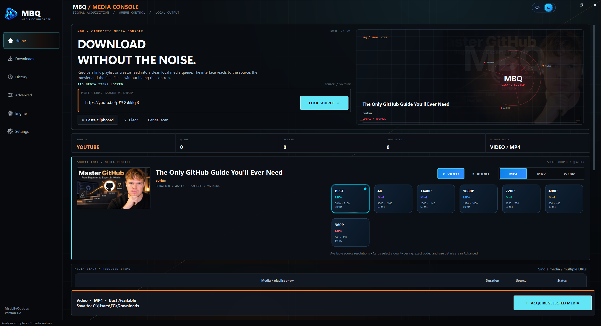
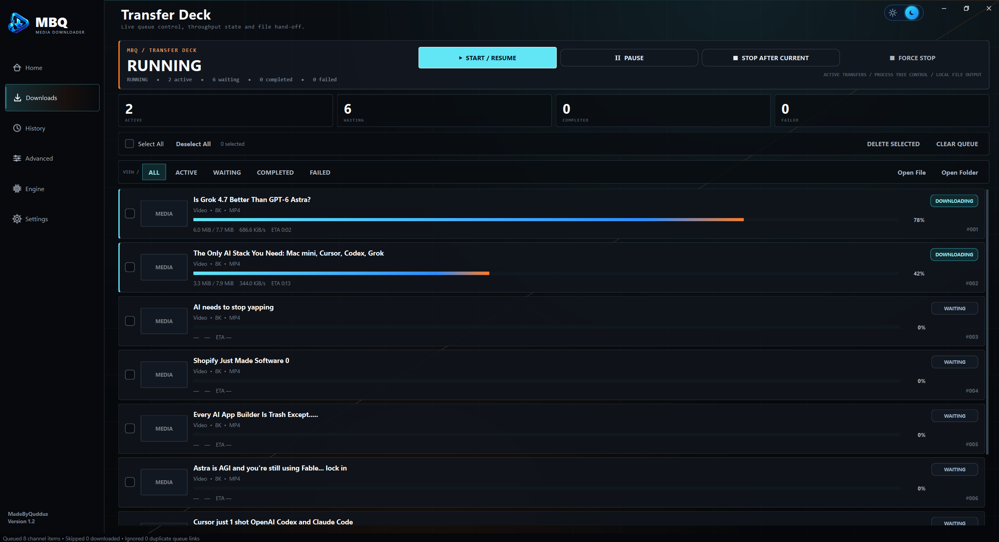
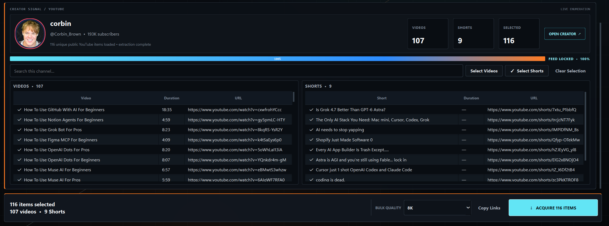
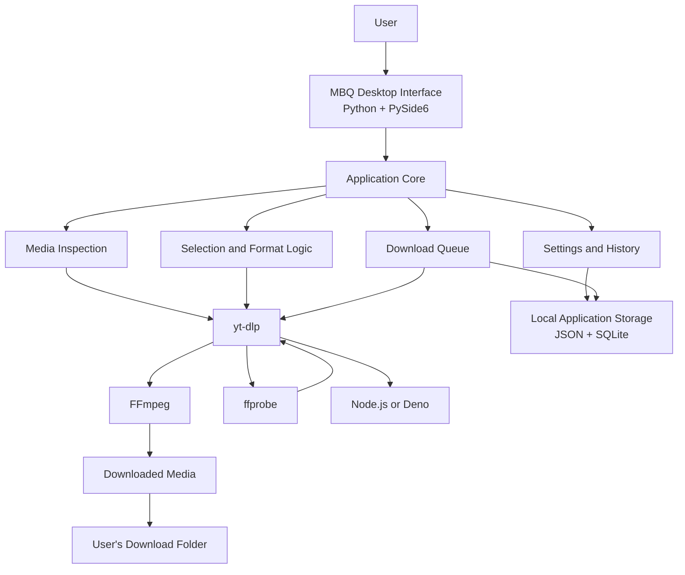

 <div align="center">

# MBQ Media Downloader

[](LICENSE)


**A Windows desktop media downloader and manager.**

Inspect available media. Select the content and formats you want. Configure your downloads, manage your queue, and keep track of your downloaded media — all from one native desktop application.

**Inspect. Select. Download. Manage.**

Built with Python and PySide6, powered by yt-dlp and FFmpeg.

**Source repository:** No third-party runtime executables are bundled by default. Review the [requirements](#requirements) before installation.

Made with ❤️ by [@madebyquddus](https://github.com/madebyquddus)

</div>

---

## Screenshots

### Dashboard

<p align="center">
  
</p>

### Download and format selection

<p align="center">
  
</p>

### YouTube channel workflow

<p align="center">
  
</p>

---

## Table of Contents

- [Overview](#overview)
- [How MBQ Works](#how-mbq-works)
- [Core Capabilities](#core-capabilities)
- [Compatibility](#compatibility)
- [Architecture](#architecture)
- [Requirements](#requirements)
- [Installation](#installation)
- [Quick Start](#quick-start)
- [Using the Application](#using-the-application)
- [Advanced Features](#advanced-features)
- [Engine Management](#engine-management)
- [Data Storage](#data-storage)
- [Building from Source](#building-from-source)
- [Testing and Verification](#testing-and-verification)
- [Project Structure](#project-structure)
- [Troubleshooting](#troubleshooting)
- [Security and Privacy](#security-and-privacy)
- [Contributing to MBQ](#contributing-to-mbq)
- [Upstream Projects and Contributions](#upstream-projects-and-contributions)
- [Roadmap](#roadmap)
- [License and Acknowledgements](#license-and-acknowledgements)

---

## Overview

MBQ Media Downloader is a Windows desktop application designed to make online media downloading more organized and controllable.

Rather than treating downloading as a single action, MBQ brings media inspection, selective content selection, format configuration, download execution, queue management, and local history into one graphical workflow.

Many download workflows involve switching between browser pages, command-line options, format identifiers, and separate download tools. MBQ provides a dedicated interface for coordinating those operations.

### The MBQ approach

**Inspect before downloading.**

Analyze a URL to retrieve available media information before committing to a download.

**Choose what you actually need.**

Review available formats, resolutions, and collection entries. Select individual items rather than automatically downloading everything.

**Control the output.**

Choose video or audio output, quality preferences, containers, and supported processing options.

**Manage the entire process.**

Monitor progress, control queued jobs, organize output, and review download history.

MBQ combines its own desktop workflow and application management with established media-processing tools. It does not attempt to replace the underlying extraction and media-processing engines.

---

## How MBQ Works

The application follows a connected workflow:

```text
        MEDIA URL
            |
            v
      1. DISCOVER
     Analyze the URL
            |
            v
       2. INSPECT
   Review media information
   and available formats
            |
            v
        3. SELECT
   Choose entries and streams
            |
            v
       4. CONFIGURE
   Quality, output and options
            |
            v
       5. DOWNLOAD
   Queue, execute and monitor
            |
            v
        6. MANAGE
   Files, queue and history
```

### 1. Discover

Enter one or more HTTP or HTTPS media URLs.

MBQ passes the request to yt-dlp for metadata extraction. Analysis does not itself download the media.

### 2. Inspect

Review the information returned by the extractor, including available formats and media metadata.

For supported collections, entries can initially be loaded as lightweight metadata instead of immediately analyzing every item's formats.

### 3. Select

Choose individual videos, playlist entries, or supported channel/profile items.

This makes it possible to select the content you actually intend to download.

### 4. Configure

Choose the output mode, container, quality preset, or exact stream identifiers where available.

Additional settings control supported metadata, subtitles, thumbnails, chapters, filename templates, and other download preferences.

### 5. Download

Selected items enter the download queue.

MBQ coordinates the jobs and communicates with the media engine while displaying progress and processing states.

### 6. Manage

Control the queue, review completed jobs, open downloaded files, organize playlist output, and search local download history.

---

## Core Capabilities

### Media inspection and extraction

- URL analysis before downloading.
- Available video and audio format inspection.
- Source-derived video quality options.
- Resolution selection from 360p through 8K when matching streams are available.
- Exact format ID selection.
- Individual playlist-entry analysis.
- Supported YouTube channel and TikTok profile workflows.
- Channel/profile entry selection and filtering.

### Video and audio output

**Video containers**

- MP4
- MKV
- WebM

**Audio formats**

- MP3
- M4A
- Opus
- WAV

Output availability depends on the source streams, codecs, extractor information, and FFmpeg processing capabilities.

### Download queue

- Persistent queue storage.
- Start and pause downloads.
- Resume paused downloads.
- Stop after the current task.
- Force-stop active work.
- Cancel selected jobs.
- Retry failed jobs.
- Move jobs to the top of the queue.
- Filter and select queue entries.
- Clear completed jobs.

Pending jobs are restored after an application restart. Interrupted jobs return to the Waiting state.

### Download history

- Local SQLite history database.
- Searchable download records.
- Duplicate detection.
- Option to skip media already recorded as completed.
- Clear history without deleting downloaded media files.

### Output organization

- Configurable download destination.
- Playlist-specific folders.
- Numbered playlist filenames.
- Windows-compatible filename sanitization.
- Custom filename templates.

### Application interface

- Native PySide6 desktop interface.
- Dark and Light themes.
- Custom MBQ visual interface.
- Configurable interface animations.
- Dedicated Home, Downloads, History, Advanced, Engine, and Settings areas.

---

## Compatibility

MBQ uses yt-dlp as its media extraction and downloading engine.

Consequently, website compatibility depends on the extractors maintained by yt-dlp, the website's current implementation, access restrictions, and the external tools available on the system.

The application does not guarantee that every website, URL, account type, or media format will work.

### Specific collection workflows

The application contains dedicated handling for:

- YouTube channels, including Videos and Shorts where supported.
- TikTok profiles.
- Playlist entries and selective item downloading.

Other websites may work through yt-dlp's available extractors, but their compatibility is not independently guaranteed by MBQ.

### Important limitations

- Website changes can break extraction without an application update.
- Some formats require additional JavaScript runtime support.
- Private or restricted media requires legitimate account access.
- Geographic restrictions and rate limits may prevent extraction.
- DRM-protected media is not bypassed.
- Available output formats depend on the source and processing tools.

For current extractor information, consult the [yt-dlp supported sites documentation](https://github.com/yt-dlp/yt-dlp/blob/master/supportedsites.md).

---

## Architecture

MBQ separates the desktop application workflow from the external media engines.



### Application responsibilities

MBQ implements:

- The graphical desktop experience.
- URL input and workflow coordination.
- Media selection and format-selection controls.
- Quality and output configuration.
- Download queue orchestration.
- Progress and status presentation.
- Application settings.
- Persistent queue and history management.
- Engine discovery and yt-dlp update management.

### External component responsibilities

| Component | Responsibility |
|---|---|
| Python | Application runtime |
| PySide6 | Native desktop interface |
| yt-dlp | Media extraction and downloading |
| FFmpeg | Merging, remuxing and audio/video processing |
| ffprobe | Media stream and output inspection |
| Node.js or Deno | JavaScript runtime support for extraction |
| SQLite | Local download history |

This separation allows the media engines to be updated independently of the desktop application.

---

## Requirements

MBQ Media Downloader targets **Windows 10/11 x64**.

There are two usage scenarios: running from source and running a packaged folder distribution.

### Required components

| Component | Requirement | Purpose |
|---|---|---|
| Windows | Windows 10/11 x64 | Desktop platform |
| Python | 3.11 or newer | Source installation |
| PySide6 | 6.7 or newer | Desktop interface |
| FFmpeg | Windows x64 | Media processing |
| ffprobe | Windows x64 | Media inspection |
| yt-dlp | Python package or standalone Windows executable | Extraction and downloading |
| Node.js or Deno | Node.js 22+ or supported Deno | JavaScript runtime support |

A JavaScript runtime is particularly important for full YouTube extraction support. Exact requirements can change as websites and yt-dlp extractors evolve.

### Python dependencies

The repository's `requirements.txt` contains:

- `PySide6-Essentials>=6.7,<7`
- `yt-dlp[default]>=2025.9.26`
- `pyinstaller>=6.10,<7`

The source installation process installs the yt-dlp Python package automatically.

A separate `yt-dlp.exe` is not required for a normal source installation unless you prefer to use the standalone engine.

### FFmpeg and ffprobe

Both executables are required for downloading and processing media.

You can provide them through:

1. The application's Engine page using **Install local FFmpeg files**.
2. The project's `tools/ffmpeg/` directory.
3. Your Windows system `PATH`.

The selected directory for local installation must contain both:

```text
tools/
└── ffmpeg/
    ├── ffmpeg.exe
    └── ffprobe.exe
```

The application copies the files you provide. It does not download FFmpeg automatically.

Official resources: [FFmpeg downloads](https://ffmpeg.org/download.html) · [FFmpeg licensing](https://ffmpeg.org/legal.html)

### yt-dlp

For source installations, yt-dlp is installed through `requirements.txt`.

Alternatively, use the application's **Engine → UPDATE yt-dlp** action to install the official Windows x64 executable.

Official project: [yt-dlp](https://github.com/yt-dlp/yt-dlp)

### JavaScript runtime

Install either:

- [Node.js 22 or newer](https://nodejs.org/)
- [Deno](https://deno.com/)

Node.js can be discovered through the system `PATH`, the application data tools directory, or the project `tools/node/` directory.

Deno can be discovered through the application data tools directory or system `PATH`.

Restart MBQ after installing or changing external engines.

---

## Installation

### Option 1 — Download the source ZIP

1. Open the [MBQ Media Downloader repository](https://github.com/madebyquddus/mbq-media-downloader).
2. Select **Code → Download ZIP**.
3. Extract the archive.
4. Open PowerShell inside the extracted project directory.

### Option 2 — Clone the repository

```powershell
git clone https://github.com/madebyquddus/mbq-media-downloader.git
cd mbq-media-downloader
```

### Install Python

Install Python 3.11 or newer:

https://www.python.org/downloads/

Verify the installation:

```powershell
py -3 --version
```

### Create a virtual environment

```powershell
py -3 -m venv .venv
```

### Upgrade pip

```powershell
.\.venv\Scripts\python.exe -m pip install --upgrade pip
```

### Install dependencies

```powershell
.\.venv\Scripts\python.exe -m pip install -r requirements.txt
```

After installing Python dependencies, provide FFmpeg, ffprobe, and a supported JavaScript runtime as explained in [Requirements](#requirements).

---

## Quick Start

Once the dependencies and external tools are available, launch MBQ:

```powershell
.\.venv\Scripts\python.exe main.py
```

On first launch:

1. Open the **Engine** page.
2. Check whether yt-dlp is detected.
3. Check whether FFmpeg and ffprobe are detected.
4. Confirm that Node.js or Deno is available.
5. Resolve any missing dependencies.

Then return to Home, enter a media URL, and select **Analyze**.

---

## Using the Application

### 1. Analyze a URL

Paste one or more HTTP/HTTPS URLs into the Home page and select **Analyze**.

MBQ retrieves media information through yt-dlp without initiating a media download.

### 2. Inspect available formats

For individual media, the application displays quality options derived from available source streams.

For playlists, entries initially load as lightweight metadata. Select an entry and use **Analyze selected formats** to inspect its available streams.

### 3. Select media and quality

Choose the desired output mode:

- Video: MP4, MKV, or WebM.
- Audio: MP3, M4A, Opus, or WAV.

Choose a quality card and select **Download** to add the checked entries to the queue.

### 4. Use Best Available

The Best Available preset selects the best available video and audio combination or an available combined stream.

Resolution presets are maximum-resolution limits, not guarantees that a source contains that resolution.

### 5. Manage downloads

The Downloads page provides queue management, filtering, progress information, and job actions.

You can inspect errors, open completed files, open their containing folders, pause or resume work, and retry failed jobs.

### 6. Configure settings

The Settings page provides controls for:

- Subtitles and automatic captions.
- Thumbnail embedding.
- Metadata embedding.
- Chapter handling.
- Output filename templates.
- Playlist folder organization.
- Duplicate-download skipping.
- Browser-session authentication.
- Download concurrency.
- Interface theme and animation preferences.

Saved settings apply to new downloads. Existing queued jobs retain their original options.

### 7. Review history

The History page provides a searchable local archive.

Clearing history also clears the associated duplicate-detection records. It does not delete the downloaded media files.

### Playlist output structure

When playlist folders are enabled, output follows an organized structure:

```text
Downloads/
└── Playlist Name/
    ├── 001 - Video Title [id].mp4
    ├── 002 - Video Title [id].mp4
    └── 003 - Video Title [id].mp4
```

Filenames are sanitized for Windows compatibility.

---

## Advanced Features

### Exact Format Selection

The Advanced tab lists available non-DRM streams for the currently selected media entry.

Depending on the source, the interface can display:

- Format ID.
- Video and audio codecs.
- Frame rate.
- Bitrate.
- Known or estimated file size.

You can select either:

**A single combined stream**

```text
22
```

**A video-only and audio-only pair**

```text
137+140
```

Compatible separate streams are merged using FFmpeg.

The application validates exact format selections and rejects invalid combinations. Exact format selection applies to the currently selected entry; other checked entries use the selected quality preset.

### Advanced yt-dlp Options

MBQ permits a restricted set of additional yt-dlp arguments:

```text
--limit-rate
--retries
--fragment-retries
--socket-timeout
--concurrent-fragments
--proxy
--user-agent
--referer
```

Other arguments are rejected.

Arguments are passed as an argument array without shell interpolation. Numeric options are subject to validation.

### Browser-session authentication

The application can optionally reuse an existing browser login session from supported browsers:

- Chrome
- Edge
- Firefox
- Brave

This uses yt-dlp's browser-cookie functionality. The user must already have legitimate access to the requested media.

---

## Engine Management

MBQ includes an Engine page for checking external dependencies and managing the standalone yt-dlp executable.

### yt-dlp updater

Use **Engine → UPDATE yt-dlp** when no download or analysis task is active.

The updater:

1. Retrieves the latest official Windows x64 release information from GitHub.
2. Downloads the official release ZIP over HTTPS.
3. Retrieves the corresponding SHA-256 checksum manifest.
4. Verifies the downloaded archive against that checksum.
5. Extracts and validates the executable.
6. Installs it into the application's local tools directory.
7. Preserves the previous installation if an update fails.

The updater performs SHA-256 checksum verification over HTTPS. This is not independent GPG signature verification.

### Engine discovery order

The application searches supported locations for external tools, including:

- `%LOCALAPPDATA%\MBQDownloader\tools\`
- Project `tools/` directories.
- System `PATH`.

For yt-dlp, source installations also have a Python module fallback:

```powershell
python -m yt_dlp
```

Packaged applications do not use that Python module fallback. They require the standalone Windows yt-dlp executable.

**Important:** Updating the Python yt-dlp package does not necessarily replace a higher-priority standalone executable. Use the Engine updater to update that executable.

---

## Data Storage

MBQ stores application data locally.

The default application data directory is:

```text
%LOCALAPPDATA%\MBQDownloader\
```

Typical contents include:

| File or directory | Purpose |
|---|---|
| `settings.json` | Application and download preferences |
| `queue.json` | Persistent download queue |
| `history.sqlite3` | Download history and duplicate detection |
| `mbq.log` | Application log |
| `tools/` | Locally installed external engines |

### Custom data directory

A custom writable directory can be configured using the `MBQ_DATA_DIR` environment variable.

Example:

```powershell
$env:MBQ_DATA_DIR = "D:\MBQData"
```

This applies to the current PowerShell session.

Settings, queue information, history, and application-installed tools are stored under the selected application data directory.

---

## Building from Source

MBQ can be packaged into a Windows folder distribution using PyInstaller.

### Build prerequisites

- Windows 10/11 x64.
- Python 3.11 or newer.
- Project dependencies installed.
- PyInstaller installed through `requirements.txt`.

### Build command

From the project root:

```powershell
powershell -ExecutionPolicy Bypass -File .\build.ps1
```

The script checks Python and PyInstaller, verifies required project files, cleans previous build output, runs PyInstaller, and copies available supporting tools and documentation.

### Alternative: direct PyInstaller command

```powershell
.\.venv\Scripts\python.exe -m PyInstaller --noconfirm --clean MBQ.spec
```

The direct command does not perform every additional step in `build.ps1`.

### Build output

The resulting distribution is generated at:

```text
dist/
└── MBQ Media Downloader/
    ├── MBQ Media Downloader.exe
    ├── _internal/
    ├── assets/
    ├── LICENSE
    ├── README.md
    ├── THIRD_PARTY_NOTICES.md
    └── ...
```

The entire output directory must remain together.

This is a **PyInstaller onedir folder distribution**, not a single-file executable or an installer. Python does not need to be installed on the target machine.

### Build warning

The included `build.ps1` removes existing `build/` and `dist/` directories before rebuilding.

Back up anything important in those directories before running the script.

### External runtime components

The default source repository does not contain third-party runtime executables.

The build does not automatically download or bundle FFmpeg, ffprobe, Node.js, Deno, or yt-dlp. These remain external and must be provided separately.

If third-party binaries are placed in `tools/` before building, the build script can copy that directory into the distribution. Anyone redistributing those binaries must satisfy the applicable upstream licensing obligations.

See [THIRD_PARTY_NOTICES.md](THIRD_PARTY_NOTICES.md).

---

## Testing and Verification

### Compile check

```powershell
.\.venv\Scripts\python.exe -m compileall -q main.py app tests
```

### Run automated tests

```powershell
.\.venv\Scripts\python.exe -m unittest discover -s tests -v
```

### Test coverage

The repository includes tests covering:

- Custom yt-dlp argument restrictions.
- URL validation.
- Filename and output-template safety.
- Windows reserved filenames.
- Available quality derivation.
- Best Available selection.
- Playlist output paths.
- Persistent settings and history.
- Download and FFmpeg integration.
- Video and audio output formats.
- DASH stream merging.
- Download cancellation.
- GUI queue and history integration.
- yt-dlp updater installation.
- Checksum mismatch handling.
- ZIP archive path traversal rejection.

Integration tests generate local media and use a local HTTP server. They do not require public media websites. Tests requiring FFmpeg or ffprobe are skipped when those tools are unavailable.

### Release verification status

Automated tests and packaging checks should be run against the exact source snapshot intended for release.

The historical `VERIFICATION.md` file records earlier development checks; it is not evidence that the current source snapshot has passed a fresh release verification.

Do not treat a successful application launch as proof that every website, engine update, download format, or packaged deployment scenario has been verified.

---

## Project Structure

```text
MBQ Media Downloader/
│
├── main.py
├── MBQ.spec
├── build.ps1
├── requirements.txt
├── README.md
├── LICENSE
├── CHANGELOG.md
├── THIRD_PARTY_NOTICES.md
├── VERIFICATION.md
│
├── app/
│   ├── core/
│   │   ├── engine.py
│   │   ├── options.py
│   │   └── storage.py
│   │
│   ├── ui/
│   │   ├── window.py
│   │   ├── neon.py
│   │   ├── neon_theme.py
│   │   ├── mbq_core.py
│   │   └── ui_config.py
│   │
│   └── workers/
│       └── tasks.py
│
├── assets/
│   └── icons/
│
├── docs/
│   └── screenshots/
│
├── devtools/
│
├── tools/
│   ├── ffmpeg/
│   ├── node/
│   └── yt-dlp/
│
└── tests/
    ├── test_core.py
    ├── test_integration.py
    ├── test_mbq.py
    └── test_updater.py
```

### Important directories

| Directory | Purpose |
|---|---|
| `app/core/` | Engine discovery, download options, and persistent storage |
| `app/ui/` | Native desktop interface and themes |
| `app/workers/` | Background extraction and download processes |
| `assets/` | Application icons and resources |
| `docs/` | Documentation and screenshots |
| `devtools/` | Development-only interface tools |
| `tools/` | Locations for user-provided external engines |
| `tests/` | Automated test suite |

---

## Troubleshooting

<details>
<summary><strong>Engine page reports missing tools</strong></summary>

Open the Engine page and inspect the detected dependencies.

Provide both FFmpeg and ffprobe using the local installation option or a supported engine location.

For full YouTube extraction support, install Node.js 22+ or Deno and ensure it is discoverable.

Restart MBQ after changing external tools.

</details>

<details>
<summary><strong>YouTube signature or nsig errors</strong></summary>

These errors can result from an outdated yt-dlp version, a missing JavaScript runtime, or changes made by the website.

Try:

1. Open Engine.
2. Select UPDATE yt-dlp.
3. Verify Node.js or Deno availability.
4. Restart MBQ.
5. Analyze the URL again.

Website changes, authentication restrictions, and rate limits can still affect extraction.

</details>

<details>
<summary><strong>Browser cookies or authenticated access fail</strong></summary>

MBQ can optionally reuse an existing supported browser login session.

Browser encryption, a locked cookie database, or an unsupported browser configuration may prevent extraction.

Try closing the browser before retrying. You must already have authorized access to the requested media.

</details>

<details>
<summary><strong>Format errors or unsupported codecs</strong></summary>

MP4 and WebM do not support every possible codec combination.

Try MKV or select a compatible stream manually in Advanced.

Best Available prioritizes the best available video/audio combination and uses remuxing where possible rather than re-encoding.

WAV conversion can produce very large files.

Thumbnail, subtitle, and metadata embedding also depend on the selected container and source support.

</details>

<details>
<summary><strong>Media is unavailable or restricted</strong></summary>

- Analyze the selected formats again if a format is unavailable.
- Verify access using your own authorized account for private or restricted media.
- Check your connection for network errors.
- Wait before retrying if the website applies rate limits.
- Check the application log if no output file is reported.

Media may have been removed, restricted, or made unavailable by the source platform.

</details>

<details>
<summary><strong>Application does not launch</strong></summary>

For source installations, verify the virtual environment and project dependencies.

Try launching directly:

```powershell
.\.venv\Scripts\python.exe main.py
```

For packaged installations, keep the executable together with its `_internal` directory and the rest of the distribution.

</details>

Logs and error details are stored locally and may contain URLs or filesystem paths. Review them before sharing.

---

## Security and Privacy

MBQ is designed around local application storage and explicit download actions.

Security-related implementation details include:

- Additional yt-dlp arguments are restricted by an explicit allowlist.
- Arguments are passed without shell interpolation.
- yt-dlp configuration files and plugin directories are disabled for application engine invocations.
- Output paths and filename templates are subject to validation.
- File-opening actions are restricted to supported media file extensions.
- Downloaded files are not executed automatically.
- Application settings, queue information, and history are stored locally.
- No application-specific cloud storage service is used for download history or settings.

Network requests are still required for media extraction, website access, and official engine updates.

The application does not circumvent DRM, paywalls, or access controls.

Only download media you have permission to access and save. Users are responsible for complying with applicable copyright laws and website terms.

---

## Contributing to MBQ

Contributions to MBQ Media Downloader are welcome.

Useful contributions include:

- Bug reports and reproducible issue descriptions.
- Documentation improvements.
- UI and accessibility improvements.
- Performance and reliability improvements.
- Automated test coverage.
- Compatibility fixes.
- Security improvements.

### Contribution workflow

1. Review the existing issues before opening a new one.
2. For substantial changes, open an issue to discuss the proposed scope.
3. Fork the MBQ repository.
4. Create a focused feature branch.
5. Make your changes.
6. Run compilation checks and the automated test suite.
7. Verify relevant behavior on Windows.
8. Submit a pull request describing the changes and test results.

### Development standards

- Preserve the native PySide6 architecture.
- Keep external engines replaceable.
- Avoid committing compiled binaries or third-party runtime executables.
- Do not introduce unnecessary dependencies.
- Include tests for behavior changes where practical.
- Do not commit credentials, private URLs, personal data, or local application databases.

Run the test suite:

```powershell
.\.venv\Scripts\python.exe -m unittest discover -s tests -v
```

The `tools/` directories in the source repository should contain only their placeholders and documentation files.

**Repository:** [madebyquddus/mbq-media-downloader](https://github.com/madebyquddus/mbq-media-downloader)

---

## Upstream Projects and Contributions

MBQ relies on established open-source projects for its runtime, interface, extraction, media processing, and packaging.

These projects are independently maintained. MBQ Media Downloader is not affiliated with, endorsed by, or maintained by their upstream teams.

If you discover a bug in an upstream component, need a feature, or want to improve the software MBQ depends on, contribute to the relevant upstream project rather than assuming the issue belongs in MBQ's source code.

| Project | Role in MBQ | Upstream repository |
|---|---|---|
| Python | Application language and runtime | [python/cpython](https://github.com/python/cpython) |
| PySide6 | Python bindings for Qt and desktop UI | [pyside/pyside-setup](https://github.com/pyside/pyside-setup) |
| yt-dlp | Media extraction and downloading | [yt-dlp/yt-dlp](https://github.com/yt-dlp/yt-dlp) |
| FFmpeg | Media processing and stream merging | [FFmpeg/FFmpeg](https://github.com/FFmpeg/FFmpeg) |
| Node.js | JavaScript runtime option | [nodejs/node](https://github.com/nodejs/node) |
| Deno | JavaScript runtime option | [denoland/deno](https://github.com/denoland/deno) |
| PyInstaller | Windows application packaging | [pyinstaller/pyinstaller](https://github.com/pyinstaller/pyinstaller) |

### How to contribute upstream

For each project:

1. Read its contribution guidelines and license.
2. Search existing issues and pull requests.
3. Reproduce the issue using the upstream component independently where possible.
4. Open an issue with relevant logs, versions, and reproduction steps.
5. Fork the upstream repository and create a focused branch.
6. Follow its testing and code-review requirements.
7. Submit a pull request to that project's official repository.

Useful upstream resources:

- [Python documentation](https://docs.python.org/3/)
- [PySide6 documentation](https://doc.qt.io/qtforpython-6/)
- [yt-dlp documentation](https://github.com/yt-dlp/yt-dlp#readme)
- [FFmpeg documentation](https://ffmpeg.org/documentation.html)
- [Node.js documentation](https://nodejs.org/docs/latest/api/)
- [Deno documentation](https://docs.deno.com/)
- [PyInstaller documentation](https://pyinstaller.org/en/stable/)

### Why upstream contributions matter

Improvements to yt-dlp extractors, FFmpeg processing, Python, Qt bindings, and packaging tools can benefit many applications beyond MBQ.

Keeping upstream contributions separate also makes it easier to identify whether a problem belongs to MBQ's implementation or to one of its external dependencies.

For licensing and redistribution details, see [THIRD_PARTY_NOTICES.md](THIRD_PARTY_NOTICES.md).

---

## Roadmap

Planned improvements:

- [ ] Additional unit coverage for `available_qualities()` using real extractor fixtures.
- [ ] Optional automatic resume of interrupted jobs on application launch.
- [ ] Additional queue actions and workflow refinements.
- [ ] More interface screenshots, including Light theme, Downloads, Advanced, and Engine.
- [ ] GitHub Actions workflow for automated Windows testing.
- [ ] Continued improvements to reliability, usability, and compatibility.

Roadmap items are planned improvements, not existing features or delivery guarantees.

Have an idea or found a problem? Open a [GitHub issue](https://github.com/madebyquddus/mbq-media-downloader/issues).

---

## License and Acknowledgements

MBQ Media Downloader application source code is released under the [MIT License](LICENSE).

Copyright (c) 2026 @madebyquddus.

Third-party components retain their respective licenses. These include:

- Python Software Foundation License.
- PySide6 and Qt licensing terms.
- yt-dlp's Unlicense and applicable third-party component licenses.
- FFmpeg licensing, which depends on the selected build and configuration.
- Node.js and its included third-party licenses.
- Deno MIT License.
- PyInstaller GPLv2-or-later license and bootloader exception.

The source repository does not bundle third-party runtime binaries by default.

**Important redistribution notice:** A PyInstaller folder distribution includes PySide6/Qt runtime libraries. Redistributing a packaged application therefore requires attention to the applicable Qt/PySide6 licensing obligations, including LGPL requirements. FFmpeg builds may also carry GPL obligations. Verify the exact licenses and required notices for every binary you distribute.

See [THIRD_PARTY_NOTICES.md](THIRD_PARTY_NOTICES.md) before redistributing packaged builds or external binaries.

---

<div align="center">

**Made with ❤️ by [@madebyquddus](https://github.com/madebyquddus)**

[MBQ Media Downloader Repository](https://github.com/madebyquddus/mbq-media-downloader)

</div>